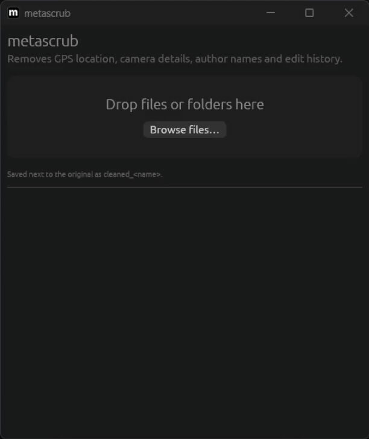

# metascrub

[](https://github.com/xorandd/metascrub/releases)
[](https://github.com/xorandd/metascrub/stargazers)
[](https://github.com/xorandd/metascrub/releases/latest)
[](https://github.com/xorandd/metascrub/releases/latest)
[](LICENSE)

**Remove the hidden data in your photos and documents before you share them.**
GPS location, camera serial numbers, author names, edit history: gone, in one drag-and-drop.



```
$ metascrub-cli holiday.jpg
✓ holiday.jpg → cleaned_holiday.jpg
    removed EXIF
      Camera model: EOS R5
      Camera serial: SN123456
      Taken: 2026:10:31 14:22:01
      GPS location: 50.45028, 30.52361
    removed Comment
    removed Hidden data after image
```

- **One small native app.** A single binary with no ExifTool, Python or Electron needed.
- **Terminal and desktop.** The same engine is behind the `metascrub` drag-and-drop window and the `metascrub-cli` command.
- **Shows what it found.** You see exactly which personal details were in the file.
- **Really removes it.** Files are rebuilt from scratch. PDFs are rewritten completely instead of patched, so old metadata can't be recovered from inside the file.
- **Your original is never touched.** The cleaned copy is saved next to it as `cleaned_<name>`.
- **Lossless.** Image pixels are copied byte for byte and never re-encoded.

## Supported files

| Format | What gets removed |
|---|---|
| JPEG | EXIF (GPS, camera, serials, dates, software), XMP, IPTC/Photoshop, comments, embedded extra images, data hidden after the image |
| PNG | Text fields (author, description...), EXIF, timestamps, unknown extra chunks, trailing data |
| WebP | EXIF, XMP, unknown chunks |
| GIF | Comments, XMP and other application blocks (animation looping is kept) |
| PDF | Document info (author, title, creator app, dates), XMP, file ID, editing-app data, comment author names |
| DOCX / XLSX / PPTX | Document properties (author, last edited by, company, template, editing time), custom properties, comment and tracked-change author names, revision IDs, saved folder path, zip timestamps |

Colour profiles and the photo rotation flag are kept so the cleaned file looks the same.
Use `--strip-orientation` to remove the rotation flag too.

## Install

Download from **[Releases](../../releases)**:

| System | Desktop app | Command line |
|---|---|---|
| Windows | `metascrub-windows-x86_64.exe` (just run it) | `metascrub-cli-windows-x86_64.exe` |
| Linux | `metascrub-x86_64.AppImage`: `chmod +x` it, then run | `metascrub-cli-linux-x86_64.tar.gz` |
| macOS (Apple Silicon and Intel) | `metascrub-macos-universal.dmg`: drag to Applications | `metascrub-cli-macos-universal.tar.gz` |

The apps aren't signed with a paid certificate yet, so on first launch:
- **Windows** may show "Windows protected your PC": click *More info → Run anyway*.
- **macOS** may say the app can't be checked: right-click the app → *Open* → *Open*, or allow it in *System Settings → Privacy & Security*.

Or build from source with Rust 1.88+:

```sh
cargo install --path cli   # metascrub-cli (terminal)
cargo install --path gui   # metascrub (desktop window)
```

### Making a release

Push a version tag and GitHub Actions builds every download above and attaches it to a release:

```sh
git tag v0.1.0
git push origin v0.1.0
```

The packaging scripts can also be run by hand: `packaging/linux/build-appimage.sh` on Linux (after `cargo build --release -p metascrub`) and `packaging/macos/build-dmg.sh` on a Mac.

## Usage

### Desktop

Open **metascrub** and drop files or folders onto the window, or click **Browse files…**.
Each file is cleaned straight away and the copy is saved next to the original.
Click a result to see what was removed. You can also drop files onto the app icon.

### Terminal

```sh
metascrub-cli photo.jpg                 # → cleaned_photo.jpg
metascrub-cli photo.jpg -o holiday      # → holiday.jpg
metascrub-cli a.jpg b.pdf report.docx   # several files at once
metascrub-cli -r ~/Pictures/to-share    # whole folder, including subfolders
metascrub-cli --show contract.pdf       # only show what's inside, write nothing
```

| Flag | Meaning |
|---|---|
| `-o, --output <NAME>` | Name for the cleaned file (single file only; the extension is added if missing) |
| `-s, --show` | List the metadata without writing anything |
| `-r, --recursive` | Process folders |
| `-f, --force` | Overwrite the `-o` file if it exists |
| `--strip-orientation` | Also remove the photo rotation flag |
| `-q, --quiet` | Only print errors |

If `cleaned_<name>` already exists, metascrub uses `cleaned_<name>_2`, `_3`, and so on. It never overwrites anything unless you pass `--force`.

## How it compares

| | metascrub | ExifCleaner | mat2 | exiftool |
|---|---|---|---|---|
| Desktop app | ✓ native | ✓ Electron | GNOME only | ✗ |
| Command line | ✓ | ✗ | ✓ | ✓ |
| Windows / macOS / Linux | ✓ | ✓ | Linux | ✓ |
| No external dependencies | ✓ | needs ExifTool | needs Python + libs | needs Perl |
| PDF metadata fully removed | ✓ (rewritten) | partial (old data recoverable) | ✓ | partial (reversible) |
| Office comment authors | ✓ | ✗ | ✓ | ✗ |

## Limitations

- Video and audio (MP4, MOV, MP3) and OpenDocument (ODT) files are not supported yet.
- Password-protected PDFs are refused rather than cleaned.
- Metadata is not the only thing that can identify you: faces, reflections, visible text and document content are not touched.

## Project layout

```
core/   the cleaning engine (library, with tests in core/tests)
cli/    the metascrub-cli command
gui/    the drag-and-drop window (egui)
assets/ app icon (png, ico, icns)
packaging/  AppImage and macOS .dmg build scripts
```

Run the tests with `cargo test`. The suite includes cleaning every sample file twice and feeding thousands of truncated or corrupted files to make sure nothing crashes.

## License

MIT
